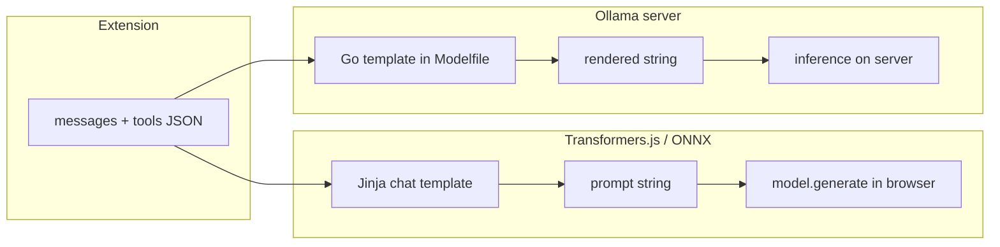

# Chat Input Processing — Transformers.js (ONNX) vs Ollama

How Dialogue turns OpenAI-shaped JSON (`messages`, optional `tools`) into the string a language model actually tokenizes. Both paths share the same **extension input**; they differ in **where** the chat template runs, **what language** it uses, and **how** the rendered prompt is surfaced in the UI.

---

## Shared entry point

Dialogue builds structured messages and sends them through the background worker:

```
dialogue/ui.js  sendDialogue()
  → dialogueChatCompletion()  { type: "dialogue.send", messages, tools? }
  → background.js
  → llm.js  chatCompletions(request, settings)
      ├─ provider "onnx"     → onnxChatCompletions → engine.js (offscreen)
      └─ provider "ollama"   → ollamaChatCompletions → Ollama HTTP API
```

| Field | ONNX path | Ollama path |
|-------|-----------|-------------|
| Model selection | `settings.onnxModel` (dropdown saves `onnxModel`) | `settings.model` (dropdown saves `model`) |
| Messages | `request.messages` | Same |
| Tools | OpenAI `tools[]` when enabled | Same |
| Temperature / max tokens | `settings.temperature`, `settings.maxTokens` | Same |

The extension never feeds raw JSON to model weights. A **chat template** converts structured messages into one prompt string; that string is tokenized and passed to inference.



---

## Transformers.js (ONNX, local)

### Where the template lives

Each Hugging Face model ships a **Jinja2** chat template in `tokenizer_config.json` (`chat_template`). Transformers.js loads it with the model tokenizer/processor in the offscreen document ([`engine.js`](../browser-agent/engine.js)).

### Processing flow

1. [`llm.js`](../browser-agent/llm.js) `onnxChatCompletions` forwards to the offscreen engine via `chat.completions`.
2. [`engine.js`](../browser-agent/engine.js) `runChatCompletions` calls `runInference` with `input: request.messages`.
3. Template application (browser, in-process with inference):

   **Text LLMs** (`invokePipeline` → `renderChatPrompt`):

   ```js
   tokenizer.apply_chat_template(messages, {
     tokenize: false,
     add_generation_prompt: true,
     tools?,  // when tool-using turn
   });
   ```

   **VLMs** (Gemma 4, Ministral): messages are normalized via `toGemmaMessages`, then `processor.apply_chat_template` with `add_generation_prompt: true` and optional `tools`. Images are loaded separately and passed to the processor alongside the text prompt.

4. The returned **string** is fed to the pipeline / `model.generate()`.
5. The same string is attached as `output.prompt` → `response.prompt` for Dialogue’s raw **Prompt** tab.

### Key properties

| Aspect | Detail |
|--------|--------|
| Runs on | Browser (offscreen document) |
| Template syntax | Jinja2 (per HF model) |
| API | `tokenizer.apply_chat_template` / `processor.apply_chat_template` |
| `tokenize: false` | Template step returns a string, not token IDs |
| `add_generation_prompt: true` | Adds assistant header so generation starts correctly |
| Model picks template | Which HF repo is loaded (`onnxModel`) |
| Prompt preview | Same call path as inference — no separate render API |

### Relevant code

| File | Role |
|------|------|
| [`llm.js`](../browser-agent/llm.js) | `onnxChatCompletions` — routes to offscreen engine |
| [`engine.js`](../browser-agent/engine.js) | `runChatCompletions`, `renderChatPrompt`, `invokePipeline`, `invokeGemma4`, `invokeMinistral` |
| [`offscreen.html`](../browser-agent/offscreen.html) | Hosts Transformers.js runtime |

---

## Ollama

### Where the template lives

Each Ollama model has a **Go `text/template`** in its Modelfile (`TEMPLATE` command). Inspect without the extension:

```bash
ollama show llama3.2 --template
curl http://127.0.0.1:11434/api/show -d '{"model": "llama3.2"}'
```

The `template` field in `/api/show` is the template **source**; it is not what the LLM sees until Ollama renders it for a specific request.

### Processing flow

1. [`llm.js`](../browser-agent/llm.js) `ollamaChatCompletions` builds requests to `settings.baseUrl` (default `http://127.0.0.1:11434`).
2. **Model name** is set on the JSON body root: `model: request.model || settings.model` — not inside `messages`.
3. **Inference** (primary): `POST /v1/chat/completions` with OpenAI-shaped body (`model`, `messages`, `tools?`, `temperature`, `max_tokens`, `stream: false`). Ollama parses JSON and applies the model’s Go template server-side.
4. **Fallback**: `POST /api/chat` with native body from `buildOllamaNativeChatBody` (`model`, `messages`, `stream`, `options.temperature`, optional `tools`).
5. **Prompt preview** (parallel, no inference): `POST /api/chat` with `_debug_render_only: true`. Response field `debug_info.rendered_template` (or `_debug_info`) → `response.prompt` in Dialogue.

The extension does **not** run Ollama templates locally; it only sends structured JSON.

### Model dropdown vs inference

| Action | Ollama API? |
|--------|-------------|
| Populate dropdown | `GET /api/tags` (list models) |
| Change dropdown | No — saves `settings.model` only |
| Send message | `POST /v1/chat/completions` or `POST /api/chat` with `model` in body |

### Key properties

| Aspect | Detail |
|--------|--------|
| Runs on | Ollama server process |
| Template syntax | Go `text/template` (per Modelfile) |
| Input to server | Structured `messages` (+ optional `tools`) |
| Output of template | Single string with model-specific special tokens |
| Model picks template | `"model"` field on request body |
| Prompt preview | Separate `_debug_render_only` call |

### Relevant code

| File | Role |
|------|------|
| [`llm.js`](../browser-agent/llm.js) | `ollamaChatCompletions`, `toOllamaChatMessages`, `buildOllamaNativeChatBody`, `ollamaFetchRenderedPrompt` |
| [`rules/ollama-cors.json`](../browser-agent/rules/ollama-cors.json) | DNR rules for loopback CORS to Ollama |
| [`background.js`](../browser-agent/background.js) | `dialogue.send` → `chatCompletions` with `settings.model` |

### Example request body (inference)

```json
{
  "model": "llama3.2",
  "messages": [
    { "role": "system", "content": "You are helpful." },
    { "role": "user", "content": "What is the capital of France?" }
  ],
  "temperature": 0.2,
  "max_tokens": 1024,
  "stream": false
}
```

Ollama renders this (Llama 3 style) to something like:

```
<|start_header_id|>system<|end_header_id|>

Cutting Knowledge Date: December 2023

You are helpful.<|eot_id|><|start_header_id|>user<|end_header_id|>

What is the capital of France?<|eot_id|><|start_header_id|>assistant<|end_header_id|>


```

(Exact tokens depend on the model’s Modelfile.)

---

## Side-by-side comparison

| | **Transformers.js (ONNX)** | **Ollama** |
|---|---------------------------|------------|
| Template source | HF `tokenizer_config.json` (Jinja2) | Modelfile `TEMPLATE` (Go) |
| Who applies template | Browser (offscreen) | Ollama server |
| Template function / API | `apply_chat_template` | Internal + `_debug_render_only` for preview |
| After template | String → tokenize → `generate()` locally | String → tokenize → inference on server |
| Tools in template | `opts.tools` on `apply_chat_template` | `tools` on request + template `.Tools` logic |
| Dialogue **JSON** tab | `messages` (+ `tools`) sent to LLM | Same |
| Dialogue **Prompt** tab | String from `apply_chat_template` | `rendered_template` from debug render |
| Inspect template definition | HF model repo / tokenizer config | `ollama show MODEL --template` or `/api/show` |

---

## Dialogue raw view

[`dialogue/ui.js`](../browser-agent/dialogue/ui.js) attaches an expandable raw panel on each turn:

| Tab | Content |
|-----|---------|
| **JSON** | Structured input (`messages`, optional `tools`) and API response — never the processed prompt |
| **Prompt** | Chat-template output string (`raw.prompt`), filled after the assistant reply |

- ONNX: `engine.js` sets `response.prompt` from the `apply_chat_template` result.
- Ollama: `llm.js` sets `response.prompt` from `_debug_render_only` (`ollamaFetchRenderedPrompt`).

Placeholder when Prompt is empty: ONNX and Ollama populate it after a reply; remote API providers (OpenAI, Anthropic) do not.

---

## Tool messages (extension behavior)

Dialogue maps completed tool turns to **user**-role text for the LLM (`Tool {name} result: …`) in `turnsToChatMessages`, rather than native `role: "tool"` messages.

Both stacks therefore format tool output as user content in practice. Ollama’s native converter (`toOllamaChatMessages`) supports `tool` / `tool_calls` if present; Ollama Modelfiles (e.g. Llama 3) may use dedicated template branches (e.g. `ipython` role) when native tool messages are used.

---

## Mental model

The chat template is **not** a chat message. It is formatting logic that turns structured chat JSON into the literal prompt string the tokenizer sees.

- **Transformers.js:** Jinja template from the HF model, applied in the browser, same step as local inference.
- **Ollama:** Go template from the Modelfile, applied on the server when each HTTP request arrives; the extension sends JSON and optionally asks for a render-only copy for the UI.

Different models (`llama3.2`, `deepseek-r1:32b`, `Qwen2.5-1.5B-Instruct`, etc.) use different templates, so the same `messages` array can produce very different prompt strings.
