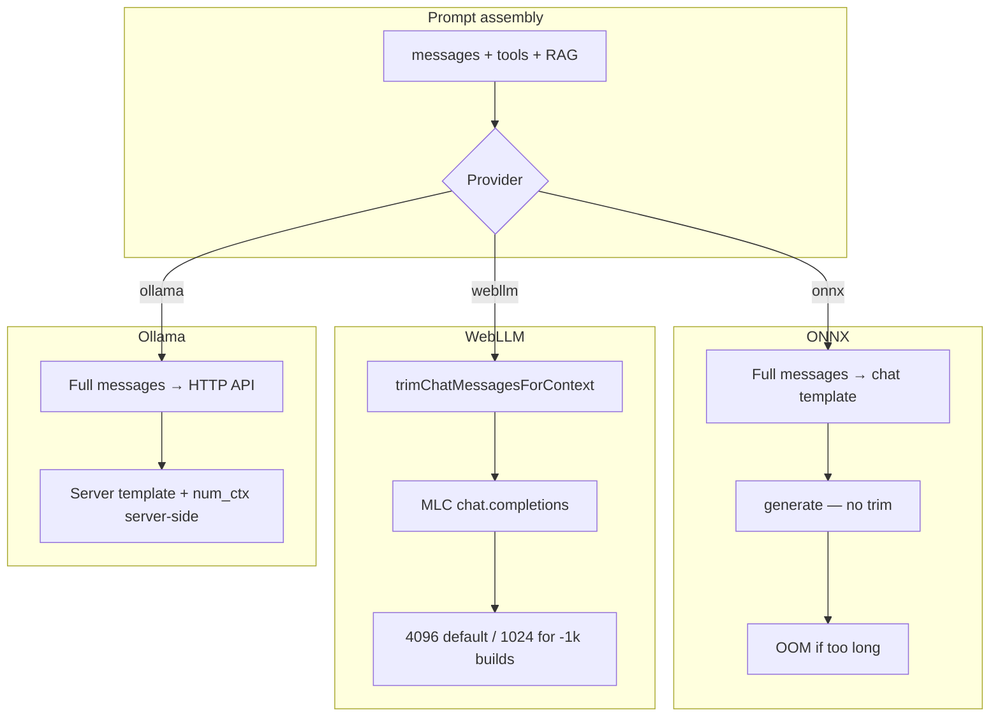

# LLM Context Limits by Backend

How **input context** (prompt + history + tools) and **output tokens** (`max_tokens`) are bounded for the three local chat providers in this extension: **ONNX Runtime (Transformers.js)**, **WebLLM**, and **Ollama**.

This doc covers **LLM chat** in Dialogue / agent loops. Embedding models (RAG) use separate, smaller windows.

---

## Shared: output token limit (`max_tokens`)

All providers read the same user setting and clamps:

| Setting | Default | Range | Source |
|---------|---------|-------|--------|
| `settings.maxTokens` | **1024** | 64 – 131,072 | [`agent-config.js`](../browser-agent/agent-config.js) |

- Mapped to Ollama native `options.num_predict`.
- Passed as `max_tokens` / `max_new_tokens` to ONNX and WebLLM engines.
- **Output limit is independent of context window** — a 1024 default reply still needs room in the *input* budget on small-context models.

---

## At-a-glance comparison

| Backend | Input context enforced by extension? | Typical usable input (this project) | Context UI | Pre-inference trimming |
|---------|--------------------------------------|-------------------------------------|------------|------------------------|
| **ONNX Runtime** | No — full messages sent to template + `generate()` | **Model trained max** down to **~hundreds–32K tokens** (memory estimate) | Settings registry + Dialogue bar | None |
| **WebLLM** | Yes — proactive trim before inference | **4096 tokens** for most catalog models; **1024** for `*-1k-MLC` builds | Settings registry + Dialogue bar | [`trimChatMessagesForContext()`](../browser-agent/context-trim.js) |
| **Ollama** | No — server owns context | **Whatever the Ollama model + server defaults allow** (not configured here) | None | None |

---

## 1. ONNX Runtime (Transformers.js)

**Code:** [`engine.js`](../browser-agent/engine.js) (offscreen), [`llm.js`](../browser-agent/llm.js) `onnxChatCompletions`, worker [`ort-worker.js`](../browser-agent/ort-worker.js).

### Trained maximum (per model)

Read from Hugging Face `config.json` via `AutoConfig`:

- `max_position_embeddings`, or
- `text_config.max_position_embeddings` (VLMs).

Registered **LLM** models and their **trained** context lengths:

| Model (registry id) | Trained max context |
|---------------------|---------------------|
| `onnx-community/Llama-3.2-1B-Instruct-ONNX` | 131K |
| `onnx-community/Qwen2.5-1.5B-Instruct` | 32K |
| `onnx-community/Llama-3.2-3B-Instruct-ONNX` | 131K |
| `mistralai/Ministral-3-3B-Instruct-2512-ONNX` | 262K |
| `onnx-community/gemma-4-E2B-it-ONNX` | 131K |
| `onnx-community/gemma-4-E4B-it-ONNX` | 131K |
| `onnx-community/Phi-3.5-mini-instruct-onnx-web` | 131K |
| `onnx-community/Qwen3-4B-Instruct-2507-ONNX` | 262K |
| `onnx-community/Qwen3-4B-ONNX` | 262K |

The extension does **not** cap generation at these values automatically; they are metadata used for **estimates** and UI.

### Effective usable context (estimate)

`getContextEstimate(modelId)` computes:

```
effectiveMaxContext = min(
  trainedMaxContext,
  memoryLimitedTokens,      // navigator.deviceMemory hint
  wasmMemoryLimitedTokens    // 4GB wasm heap + weights + KV cache
)
```

Heuristics (see constants at top of [`engine.js`](../browser-agent/engine.js)):

| Assumption | Value |
|------------|-------|
| KV cache bytes/token | fp16 on WebGPU (2 bytes/element), fp32 on wasm/CPU (4 bytes/element) |
| `navigator.deviceMemory` | Bucketed browser hint (max 8 GB reported); **50%** treated as available for KV |
| WASM linear memory | 4 GB cap; **768 MB** runtime reserve; **85%** of heap treated as usable before weights |

**Binding constraint** when effective &lt; trained:

- `wasm` — WASM 4 GB heap (common on CPU/wasm path and when wasm estimate is lowest).
- `device-memory` — device memory estimate is the bottleneck.
- Shown in Settings as e.g. `131K max · ~32K usable (est. · WASM 4GB cap)`.

**Example estimates** (8 GB `deviceMemory`, registry `approxSizeMB`, WebGPU unless `forceCpu`):

| Model | Trained max | ~Usable (est.) | Usual binder |
|-------|-------------|----------------|--------------|
| Llama 3.2 1B | 131K | ~32K | WASM heap |
| Qwen 2.5 1.5B (`forceCpu`) | 32K | ~21K | WASM heap |
| Llama 3.2 3B | 131K | ~4K | WASM heap |
| Phi 3.5 mini | 131K | ~684 | WASM heap |
| Qwen3 4B Instruct | 262K | ~646 | WASM heap |
| Gemma 4 E2B (VLM) | 131K | ~10K | WASM heap |
| Ministral 3 3B (VLM) | 262K | ~17K (device) / 0 WASM | Mixed |

Estimates omit VLM **image tokens**, GPU sharing (e.g. Ollama on the same GPU), and activations — **real usable context is often lower**.

### Runtime behavior

- **No** `trimChatMessagesForContext` on the ONNX path.
- Full `messages` (+ optional `tools` in template) go through `apply_chat_template` → `model.generate()`.
- Overflow tends to surface as **OOM / GPU errors**, with hints to unload models or reduce `max_tokens` ([`gpuErrorHint()`](../browser-agent/engine.js)).
- `Qwen2.5-1.5B-Instruct` is pinned to **CPU/wasm** (`forceCpu: true`) because WebGPU corrupts its output — context is especially tight on that path.

### UI

- **Settings** — per-model line under each LLM in the ONNX registry (`engine.contextEstimate`).
- **Dialogue** — context bar when `provider === "onnx"` ([`renderDialogueContextBar()`](../browser-agent/dialogue/ui.js)).

### Dialogue tool payload caps (not the model window, but affects prompt size)

| Limit | Value |
|-------|-------|
| Tool result chars | 8000 |
| `get_page_html` HTML field | 6000 chars before stringify |

---

## 2. WebLLM

**Code:** [`webllm-engine.js`](../browser-agent/webllm-engine.js), worker [`webllm-worker.js`](../browser-agent/webllm-worker.js), vendor [`webllm.min.js`](../browser-agent/vendor/webllm/webllm.min.js) `prebuiltAppConfig`.

### Per-model context window

Each chat model’s limit comes from the MLC bundle:

```js
contextWindow = m.overrides?.context_window_size ?? 4096
```

([`buildRegistry()`](../browser-agent/webllm-engine.js))

| Catalog pattern | Context window |
|-----------------|----------------|
| Most chat models (default) | **4096** tokens |
| Suffix `*-1k-MLC` | **1024** tokens |
| Some older/smaller builds | **2048** tokens |

The bundled catalog has ~123 chat models at 4096, ~26 at 1024, and ~10 at 2048 (counts from the vendored `webllm.min.js`).

**Onboarding default:** `Llama-3.2-3B-Instruct-q4f16_1-MLC` → **4096** context.

`getContextEstimate()` sets both `trainedMaxContext` and `effectiveMaxContext` to `contextWindow` — **no memory-based downshift** in code (OOM is handled at runtime).

### Proactive trimming (enforced)

Before `engine.chat.completions.create()`:

```js
budget = max(256, contextLimit - maxOutputTokens - 256)
trimChatMessagesForContext(messages, tools, contextLimit, maxTokens)
```

([`context-trim.js`](../browser-agent/context-trim.js))

- Keeps **system** messages; drops **oldest non-system** turns until the char-based estimate fits.
- Shrinks oversized single messages / system text if still over budget.
- Token estimate: ~**3 chars/token** + fixed overhead for tools/messages.
- Response may include `context_trimmed: { droppedTurns, estimatedTokens, contextLimit }`.
- Dialogue shows an info turn when older messages were dropped ([`noteWebllmContextTrim()`](../browser-agent/dialogue/ui.js)).

If trimming is insufficient, WebLLM throws `ContextWindowSizeExceededError` — user message suggests new chat, unpin RAG, or switch to ONNX/Ollama.

### Runtime requirements

- **WebGPU required** — no CPU/wasm fallback for chat.
- Vision/audio tools still use the **ONNX** engine.

### UI

- **Settings** — context shown in WebLLM model meta (`formatWebllmRegistryMeta`).
- **Dialogue** — context bar when `provider === "webllm"`.

### Dialogue tool payload caps

| Limit | Value |
|-------|-------|
| Tool result chars | **3000** (smaller than ONNX/Ollama) |
| `get_page_html` HTML field | 6000 chars |

WebLLM tool calling is only sent for models in `functionCallingModelIds`; other models get tools stripped in [`dialogueCompletionTools()`](../browser-agent/dialogue/ui.js).

---

## 3. Ollama

**Code:** [`llm.js`](../browser-agent/llm.js) `ollamaChatCompletions`, `buildOllamaNativeChatBody`, [`ollama-models.js`](../browser-agent/ollama-models.js) (catalog only — no context metadata).

### What this project configures

| Parameter | Set by extension? | Notes |
|-----------|-------------------|-------|
| Context window (`num_ctx`) | **No** | Not passed in `/v1/chat/completions` or native `/api/chat` body |
| Max output (`num_predict`) | **Yes** | From `settings.maxTokens` → `options.num_predict` on native path |
| Temperature | Yes | `settings.temperature` |
| Thinking | Yes | `think: request.thinkingEnabled !== false` |

The extension sends structured `messages` (+ optional `tools`) to the Ollama server. **Context sizing is entirely Ollama’s responsibility** (model card, Modelfile, server defaults, and any `num_ctx` the user set outside this extension).

### No client-side limits in this repo

- No `getContextEstimate` for Ollama.
- No Dialogue context bar (`renderDialogueContextBar` skips Ollama).
- No `trimChatMessagesForContext`.
- No `num_ctx` in [`buildOllamaNativeChatBody()`](../browser-agent/llm.js).

### Practical context (external to extension)

Usable context depends on the **pulled model tag** (e.g. `llama3.2`, `qwen2.5:7b`) and Ollama runtime settings. Many library models support large trained contexts (e.g. 32K–128K), but **default `num_ctx` on the server is often much smaller** until changed via environment, Modelfile, or API options.

To inspect or change context on the Ollama side:

```bash
ollama show <model> --modelfile
# or
curl http://127.0.0.1:11434/api/show -d '{"model":"<model>"}'
```

To set context for a run (not done by this extension today):

```json
{ "options": { "num_ctx": 8192 } }
```

### Dialogue tool payload caps

| Limit | Value |
|-------|-------|
| Tool result chars | 8000 |
| `get_page_html` HTML field | 6000 chars |

### Agent loop truncation (all providers)

ReAct agent transcripts also cap tool results at **8000** chars ([`WebApp.js`](../browser-agent/WebApp.js)); editor loops use the same ([`editor-loop.js`](../browser-agent/editor-loop.js)).

---

## End-to-end flow



---

## Related docs

- [Chat input processing](./chat-input-processing.md) — how messages become prompts (ONNX vs Ollama).
- [RAG](./rag.md) — pinned excerpts and `search_documents` add tokens to the same context budget.
- [Tools](./tools.md) — `read_page` / `fetch_url` truncation for browser tools.

---

## Key source files

| File | Role |
|------|------|
| [`agent-config.js`](../browser-agent/agent-config.js) | `maxTokens` default and clamps |
| [`context-trim.js`](../browser-agent/context-trim.js) | WebLLM-only prompt trimming |
| [`engine.js`](../browser-agent/engine.js) | ONNX `getContextEstimate`, inference |
| [`webllm-engine.js`](../browser-agent/webllm-engine.js) | WebLLM registry context + trim + chat |
| [`llm.js`](../browser-agent/llm.js) | Provider routing; Ollama HTTP |
| [`dialogue/ui.js`](../browser-agent/dialogue/ui.js) | Context bar, WebLLM trim notice, tool char limits |
| [`sidepanel.js`](../browser-agent/sidepanel.js) | Settings context estimate display |
