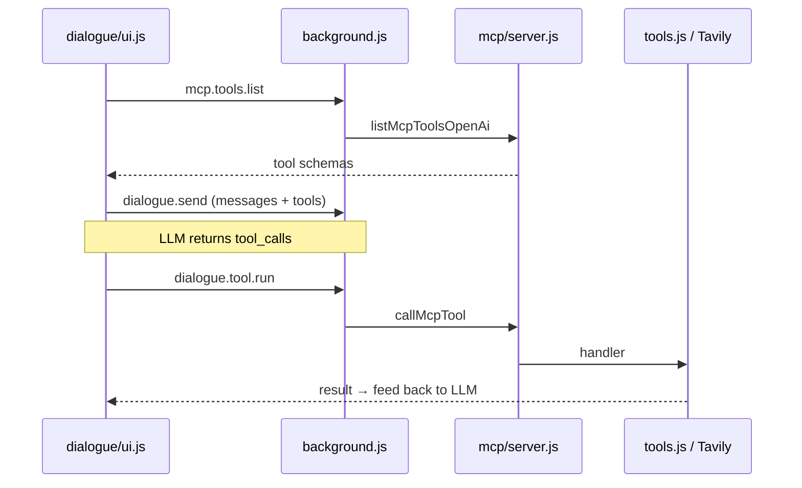

# In-Extension MCP Tool Server (`mcp/`)

The `browser-agent/mcp/` package implements **MCP-style tool semantics** (`tools/list` + `tools/call`) inside the Chrome extension. It is **not** a separate MCP process over stdio/JSON-RPC. It is a registry and dispatcher for built-in Dialogue tools (web search + browser automation).

---

## Overview

| File | Role |
|------|------|
| [`mcp/server.js`](../browser-agent/mcp/server.js) | Registry (`Map`), `registerMcpTool`, `listMcpTools`, `callMcpTool` |
| [`mcp/register-tools.js`](../browser-agent/mcp/register-tools.js) | Registers built-in tools at startup |
| [`mcp/schema.js`](../browser-agent/mcp/schema.js) | Converts MCP tool schemas ↔ OpenAI `chat.completions` function tools |
| [`mcp/index.js`](../browser-agent/mcp/index.js) | Re-exports the above |

At load, [`background.js`](../browser-agent/background.js) calls `registerBuiltinMcpTools()`. The Dialogue UI talks to the background via Chrome messages; the background calls `listMcpTools` / `callMcpTool`.

```
dialogue/ui.js
  ├─ mcp.tools.list      → background → listMcpTools / listMcpToolsOpenAi
  ├─ dialogue.send       → background → chatCompletions (LLM returns tool_calls)
  └─ dialogue.tool.run    → background → callMcpTool → handler
```

---

## `server.js` — core API

### Registry

Tools live in an in-memory `Map<string, McpToolDef>`. Each definition has:

| Field | Purpose |
|-------|---------|
| `name` | Unique key |
| `description` | Shown to the model |
| `inputSchema` | JSON Schema for arguments (MCP-style) |
| `groups` | Tags for filtering (e.g. `dialogue`, `browser`, `network`) |
| `isEnabled(settings)` | Optional gate based on user settings |
| `handler(args, context)` | Async implementation |

### `registerMcpTool(def)`

Adds or replaces a tool. Requires `name` and `handler`. Defaults `groups` to `["dialogue"]` and `inputSchema` to `{ type: "object", properties: {} }`.

### `listMcpTools({ groups, settings })`

Implements **MCP `tools/list`**:

- If `groups` is set, only tools whose `groups` overlap are returned.
- If `settings` is set, tools with `isEnabled` returning `false` are skipped.
- Returns **schema only** (name, description, inputSchema) — handlers are not exposed.

### `listMcpToolsOpenAi(options)`

Same filtering as `listMcpTools`, then converts via `schema.js` to OpenAI function-tool shape (`type: "function"`, `parameters` instead of `inputSchema`).

### `callMcpTool(name, args, context)`

Implements **MCP `tools/call`**:

1. Look up tool by name (throws if unknown).
2. Re-check `isEnabled` when `context.settings` is present.
3. Run `handler(args, context)` and return the result.

`context` typically includes `settings` (API keys, toggles) and `tabId` (active tab for browser tools).

---

## Built-in tools (`register-tools.js`)

Registered at startup:

| Tool | Group | Handler | Settings gate |
|------|-------|---------|---------------|
| `web_search` | dialogue, network | Tavily via [`dialogue/tool-runtime.js`](../browser-agent/dialogue/tool-runtime.js) | `dialogueWebSearch !== false` |
| `browser_snapshot`, `browser_click` | dialogue, browser | [`tools/a11y/`](../browser-agent/tools/a11y/) | `dialogueBrowserTools !== false` |
| `read_page`, `get_links`, `list_tabs`, `open_tab`, `navigate`, `click`, `type_text`, `scroll`, `fetch_url`, `download_file`, `get_page_html`, `modify_element`, `execute_script`, `wait` | dialogue, browser | [`tools/browser.js`](../browser-agent/tools/browser.js) | `dialogueBrowserTools !== false` |
| `search_documents`, `list_documents`, `delete_document` | dialogue, rag | [`rag/search.js`](../browser-agent/rag/search.js), [`rag/rag-store.js`](../browser-agent/rag/rag-store.js) | `dialogueRagTools !== false` |

See [`documents/rag.md`](rag.md) for PDF ingest, embedding backends, and the citation-linked PDF viewer.

Browser tools use a `withTabId` wrapper: resolve `tabId` from args → context → active tab in the current window.

### Ref-based interaction (`browser_snapshot` + `browser_click`)

1. Model calls `browser_snapshot` → receives YAML with `[ref=e3]`, `[ref=e5]`, etc.
2. Model calls `browser_click` with `target: "e5"` (or a CSS selector).
3. After navigation or DOM updates, model calls `browser_snapshot` again — refs from an old snapshot are rejected as stale.

Refs are stored as `data-ba-ref` attributes on the live page; a per-tab generation counter in the background invalidates refs after each new snapshot.

---

## Dialogue integration

### Listing tools for the model

[`dialogue/ui.js`](../browser-agent/dialogue/ui.js) calls `mcp.tools.list` with `groups: ["dialogue"]` and UI toggle overrides (`dialogueWebSearch`, `dialogueBrowserTools`). It merges returned `openAiTools` with user-defined custom tools from the form.

### Executing tools

When the model requests a tool (native `tool_calls` or parsed `call:<name>{…}` text for local ONNX models), the UI calls `dialogue.tool.run` → `callMcpTool`. Results are fed back into the chat (`role: "tool"` for native calls, or user-role result text for text-embedded calls).

### Custom “Add tool” entries

Tools defined in the Dialogue form ([`dialogue/tools.js`](../browser-agent/dialogue/tools.js)) are **schema-only**: name, description, parameters → OpenAI `tools[]`. They appear in the LLM request but **do not run** unless also registered via `registerMcpTool`. Unregistered names fail with `Unknown MCP tool`.

---

## MCP vs direct function calling

MCP does **not** replace LLM function calling. It sits **under** it.

| Layer | What happens | In this codebase |
|-------|----------------|------------------|
| Model → “call a tool” | Provider returns `tool_calls` or `call:…` text | `dialogueChatCompletion` → `normalizeAssistantToolCalls` |
| Extension → run it | Map name + args to real code | `runDialogueTool` → `callMcpTool` → handler |

### vs Automation agent (`agent.js`) — direct function map

The classic browser automation path is direct:

```javascript
// background.js passes import * as tools from "./tools.js"
const fn = tools[name];
return fn(effectiveArgs);
```

No registry, no `mcp.tools.list`, no message bridge.

**MCP adds:**

1. **Schema separate from handler** — list/export schemas for the model without exposing implementation.
2. **Dynamic enable/disable** — `isEnabled(settings)` hides tools from the model and blocks execution.
3. **Grouping** — filter by `groups` (e.g. only `dialogue` tools).
4. **Cross-context bridge** — sidepanel cannot call `chrome.*`; execution runs in the background service worker.
5. **Single registration point** — builtins in `register-tools.js`; same server can serve multiple consumers.

`callMcpTool("read_page", …)` ultimately calls the same [`tools.js`](../browser-agent/tools.js) functions as the agent — extra indirection, not different browser behavior.

### Comparison table

| Approach | Model sees tools? | Code runs? | Settings / toggles | Where it lives |
|----------|-------------------|------------|--------------------|----------------|
| LLM function calling only (custom UI tool) | Yes | Only if registered on MCP server | No | Schema in session / form |
| MCP workflow | Yes (filtered list) | Yes (handlers in registry) | Yes | `mcp/server.js` + `register-tools.js` |
| Agent direct `tools[name]()` | No (prompt lists tools) | Yes | Agent settings | `agent.js` + `tools.js` |

---

## End-to-end flow (Dialogue)



---

## Related docs

- [`tools.md`](tools.md) — implementation of browser tools (`read_page`, `click`, etc.)
- [`agent.md`](agent.md) — automation agent loop that calls `tools.js` directly (no MCP layer)
