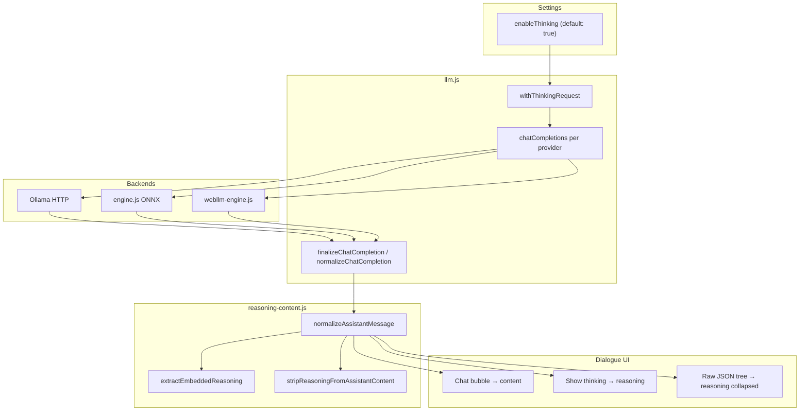

# Model Reasoning (Thinking) — Provider Output & Display Alignment

How reasoning-capable models (Qwen3, DeepSeek-R1, Gemma 4 thinking mode, etc.) emit their internal chain-of-thought on each backend, and how the extension normalizes that into one display shape in Dialogue.

This doc covers **model reasoning** only. It is separate from the Agent / System Editor **trace** `thinking` events, which come from JSON `thought` fields in the tool-calling loop (see [agent.md](./agent.md)).

---

## User setting

| Setting key | UI | Default |
|-------------|-----|---------|
| `settings.enableThinking` | Settings → **Enable model reasoning (thinking)** | **On** (`!== false`) |

When **on**, each provider enables thinking at the API/template layer (where supported). When **off**, thinking is disabled at generation time and any leftover reasoning text is stripped.

Implementation: [`reasoning-content.js`](../browser-agent/reasoning-content.js) `isThinkingEnabled()`, wired from [`llm.js`](../browser-agent/llm.js) `withThinkingRequest()` / `finalizeChatCompletion()`.

---

## Unified shape (after normalization)

Every local chat provider is consumed through OpenAI-shaped `chat.completion` responses. Before the UI sees a reply, [`normalizeChatCompletion()`](../browser-agent/reasoning-content.js) rewrites each assistant `message` to:

```json
{
  "role": "assistant",
  "content": "Final answer shown to the user.",
  "reasoning": "Optional internal chain-of-thought (collapsed by default in UI)."
}
```

| Field | Meaning |
|-------|---------|
| `content` | Final answer only — shown in the Dialogue bubble |
| `reasoning` | Thinking trace — hidden by default; expandable via **Show thinking** or the raw JSON tree |

Provider-specific field names (`thinking`, `reasoning_content`, embedded XML tags) are merged into `reasoning`. Aliases are removed from the normalized message so the raw panel uses one key.

---

## End-to-end flow



```
dialogue/ui.js  sendDialogue()
  → background.js  dialogue.send
  → llm.js  chatCompletions(request, settings)
      ├─ withThinkingRequest()     // adds request.thinkingEnabled
      ├─ provider handler        // onnx | webllm | ollama | …
      └─ finalizeChatCompletion()  // normalize all choices
  → dialogue/ui.js
      ├─ bubble: message.content
      ├─ "Show thinking": message.reasoning
      └─ raw panel: full response; reasoning keys start collapsed
```

---

## How each provider outputs reasoning (native format)

### Ollama

**Where inference runs:** Ollama server (`settings.baseUrl`, default `http://127.0.0.1:11434`).

**Enable/disable thinking:**

```json
{
  "model": "qwen3",
  "messages": […],
  "think": true,
  "stream": false
}
```

Sent on both `POST /v1/chat/completions` and native `POST /api/chat` ([`llm.js`](../browser-agent/llm.js) `buildOllamaNativeChatBody()`). `think` follows `request.thinkingEnabled` (default `true`).

**Native response shape** (thinking models):

```json
{
  "message": {
    "role": "assistant",
    "content": "Hello! How can I assist you today?",
    "thinking": "Okay, the user said \"hi\". I should respond politely…"
  }
}
```

Some builds or OpenAI-compatible responses may use `reasoning` or `reasoning_content` instead of `thinking`. The extension maps all of these in [`ollamaAssistantMessage()`](../browser-agent/llm.js) before normalization.

| Aspect | Detail |
|--------|--------|
| Separation | **Structured** — thinking is a sibling field, not mixed into `content` |
| Extension mapping | `thinking` / `reasoning` / `reasoning_content` → `message.reasoning` |
| Model list hint | [`ollama-models.js`](../browser-agent/ollama-models.js) tags models with a `thinking` capability |

---

### WebLLM (MLC)

**Where inference runs:** Offscreen document → [`webllm-engine.js`](../browser-agent/webllm-engine.js) (WebGPU).

**Enable/disable thinking** (Qwen3 family only):

```javascript
body.extra_body = { enable_thinking: request.thinkingEnabled !== false };
```

WebLLM defaults Qwen3 to thinking **on**; the extension passes `enable_thinking: false` only when the user disables the setting ([`isQwen3ThinkingModel()`](../browser-agent/reasoning-content.js) — model ids starting with `Qwen3`).

**Typical raw output** when thinking is on and not fully split by the runtime:

```
<think>
Okay, the user said "hi"…
</think>

Hello! How can I assist you today?
```

DeepSeek-style models may use `…` delimiters with the answer after the closing tag.

| Aspect | Detail |
|--------|--------|
| Separation | **Embedded in `content`** as plain text (not a separate API field) |
| Extension mapping | [`extractEmbeddedReasoning()`](../browser-agent/reasoning-content.js) splits tags into `reasoning`; remainder → `content` |
| `/no_think` in user text | **Not reliable** in WebLLM — chat templates are compiled at MLC build time |

---

### ONNX Runtime (Transformers.js)

**Where inference runs:** Offscreen document → [`engine.js`](../browser-agent/engine.js).

**Enable/disable thinking:**

| Model family | Mechanism |
|--------------|-----------|
| **Qwen3** (HF repo id contains `qwen3`) | `enable_thinking` passed to `tokenizer.apply_chat_template()` via `templateThinkingExtra()` |
| **Gemma 4** | `processor.apply_chat_template({ enable_thinking })` in `invokeGemma4()` / `renderPromptFromEntry()` |
| **Other text LLMs** | No template flag; if thinking appears as special tokens, `batch_decode({ skip_special_tokens: true })` may drop them without surfacing reasoning |

**Typical output paths:**

1. **Embedded tags** in decoded completion text (same as WebLLM) → split by `extractEmbeddedReasoning()`.
2. **Special tokens** stripped at decode — reasoning may never appear in the raw string (model-dependent).

| Aspect | Detail |
|--------|--------|
| Separation | Mixed — often embedded text; sometimes removed at token decode |
| Extension mapping | Same `normalizeAssistantMessage()` as other providers |
| Prompt preview | `enable_thinking` reflected in ONNX prompt render for Qwen3 / Gemma 4 |

---

### Remote providers (OpenAI, Anthropic, …)

[`finalizeChatCompletion()`](../browser-agent/llm.js) still runs for all providers. If a remote API returns `reasoning`, `thinking`, or `reasoning_content` on the assistant message, it is normalized into `reasoning`. Remote-specific request flags are not set by this extension today.

---

## Normalization rules ([`reasoning-content.js`](../browser-agent/reasoning-content.js))

`normalizeAssistantMessage(message, { thinkingEnabled })` runs in this order:

1. **Collect explicit fields** — first non-empty of `reasoning`, `thinking`, `reasoning_content`.
2. **Extract embedded blocks** from `content`:
   - `<think>…</think>` (Qwen3 / WebLLM)
   - `…` (DeepSeek-style)
3. **Merge** embedded text into `reasoning` (append if both explicit and embedded exist).
4. **If thinking disabled** — run `stripReasoningFromAssistantContent()` on `content` and clear `reasoning`.
5. **Emit** `{ role, content, reasoning? }` with provider aliases removed.

When thinking is **enabled**, `content` is always the user-facing answer; reasoning never duplicates in the bubble.

---

## Dialogue display alignment

All providers share the same UI path in [`dialogue/ui.js`](../browser-agent/dialogue/ui.js).

| Surface | What the user sees | Default visibility |
|---------|-------------------|-------------------|
| **Chat bubble** | `message.content` | Visible |
| **Show thinking** button | `turn.reasoning` in a `<pre>` block | **Hidden** (click to expand) |
| **Show raw → JSON** | Full `response` object including `choices[].message.reasoning` | `reasoning` / `thinking` / `reasoning_content` keys **start collapsed** ([`raw-json-view.js`](../browser-agent/dialogue/raw-json-view.js)) |
| **Show raw → Prompt** | Rendered chat template (ONNX / Ollama only) | N/A for reasoning |

**Message history for the next turn:** [`turnToMessage()`](../browser-agent/dialogue/ui.js) sends only `content` back to the model, not `reasoning` — avoids replaying chain-of-thought into subsequent requests.

**Agent / automation:** [`llm.chat()`](../browser-agent/llm.js) returns normalized `content` only (no reasoning in the string returned to `agent.js`).

---

## Comparison table

| | **Ollama** | **WebLLM** | **ONNX** |
|---|------------|------------|----------|
| **Thinking toggle** | `think: true/false` | `extra_body.enable_thinking` (Qwen3) | `enable_thinking` in chat template (Qwen3, Gemma 4) |
| **Default** | On (`think: true`) | On | On |
| **Native format** | Separate `message.thinking` | Tags inside `content` | Tags in decoded text or stripped special tokens |
| **Normalized field** | `reasoning` | `reasoning` | `reasoning` |
| **Bubble** | `content` | `content` | `content` |
| **Expandable trace** | Show thinking | Show thinking | Show thinking |
| **Raw JSON** | `reasoning` collapsed | `reasoning` collapsed | `reasoning` collapsed |

---

## Agent trace `thinking` (not model reasoning)

The Automation and System Editor tabs show italic gray **thinking** lines in the trace panel. Those are **not** model chain-of-thought:

```javascript
// agent.js / editor-loop.js — JSON tool loop only
onEvent({ type: "thinking", content: parsed.thought || "" });
```

They appear when the model returns `{ "thought": "…", "tool": "…" }` in the ReAct JSON protocol. Styling: `.trace .thinking` in [`sidepanel.css`](../browser-agent/sidepanel.css). This path is provider-agnostic and unrelated to `settings.enableThinking`.

---

## Relevant code

| File | Role |
|------|------|
| [`reasoning-content.js`](../browser-agent/reasoning-content.js) | `isThinkingEnabled`, extract/strip/normalize |
| [`llm.js`](../browser-agent/llm.js) | Request flag, Ollama `think`, `finalizeChatCompletion` |
| [`webllm-engine.js`](../browser-agent/webllm-engine.js) | WebLLM `extra_body.enable_thinking` |
| [`engine.js`](../browser-agent/engine.js) | ONNX template `enable_thinking`, decode |
| [`dialogue/ui.js`](../browser-agent/dialogue/ui.js) | Bubble, **Show thinking**, turn storage |
| [`dialogue/raw-json-view.js`](../browser-agent/dialogue/raw-json-view.js) | Collapsed `reasoning` keys in raw tree |
| [`sidepanel.html`](../browser-agent/sidepanel.html) | Settings checkbox |
| [`chat-input-processing.md`](./chat-input-processing.md) | Complementary doc — how *input* messages become prompts |

---

## Related reading

- [Ollama thinking capability](https://docs.ollama.com/capabilities/thinking)
- [WebLLM Qwen3 `enable_thinking`](https://github.com/mlc-ai/web-llm/commit/089bbd0ce77ba5395a68409ef3ca9916f36e1974)
- [Qwen3 thinking / non-thinking modes](https://qwen.readthedocs.io/en/latest/deployment/vllm.html#thinking-non-thinking-modes)
