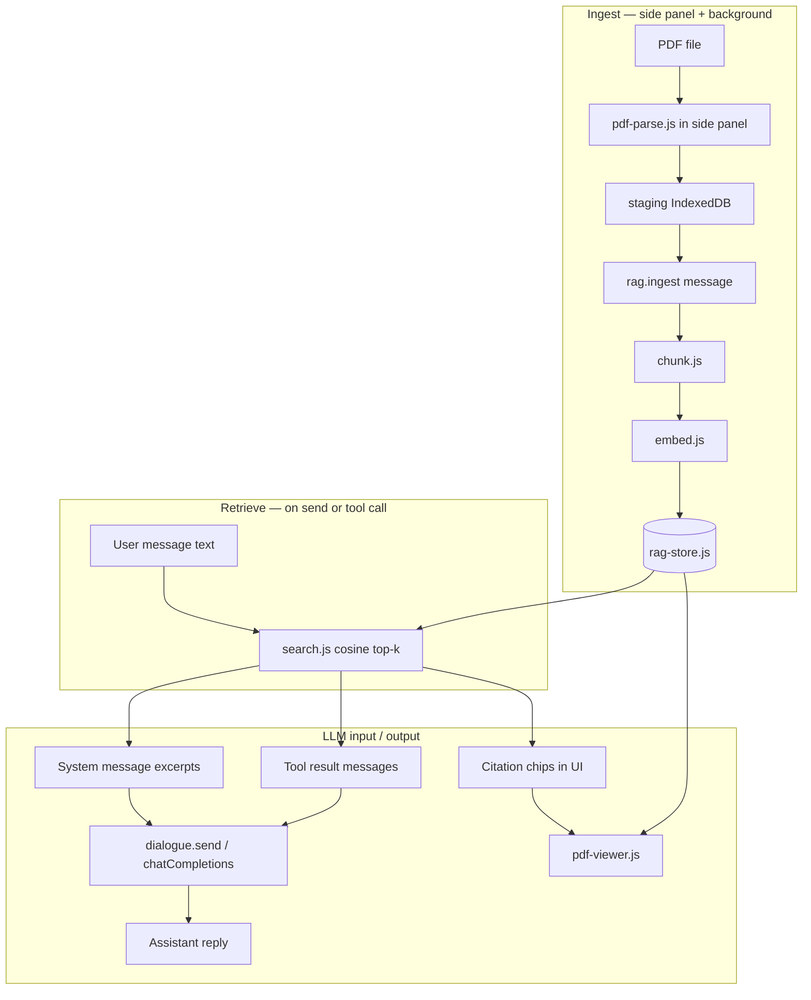

# RAG (PDF Document Search)

Semantic search over user-ingested PDFs in **Dialogue**. PDFs are parsed into text, split into chunks, embedded locally, and stored in IndexedDB. Retrieved chunks reach the LLM in two ways: **pinned auto-retrieve** (injected before the first completion) or **`search_documents`** (tool call during the agent loop).

---

## End-to-end flow



1. **Attach PDF** (Dialogue → 📄) → extract text → stage bytes → chunk → embed → store blob + vectors.
2. **Ask a question** → pinned docs: excerpts go into the **system** message; otherwise the model calls **`search_documents`**.
3. **Verify sources** → citation chips on the user/tool bubble → PDF viewer highlights the chunk on the page.

---

## Code components

### Core (`browser-agent/rag/`)

| Module | Role |
|--------|------|
| [`rag-store.js`](../browser-agent/rag/rag-store.js) | IndexedDB `rag-documents` v2: `documents`, `chunks`, `pdfBlobs`, `staging` (short-lived PDF bytes before ingest) |
| [`pdf-parse.js`](../browser-agent/rag/pdf-parse.js) | pdf.js text extraction per page (`{ page, text }[]`). Runs in the **side panel** (not the service worker — `import()` is blocked there) |
| [`chunk.js`](../browser-agent/rag/chunk.js) | Sliding-window chunking with `loc: { page, charStart, charEnd }` for PDF highlights |
| [`config.js`](../browser-agent/rag/config.js) | Embed provider/model resolution, chunk defaults, BGE/E5 `query:` / `passage:` prefixes |
| [`vectors.js`](../browser-agent/rag/vectors.js) | Per-(provider, model) embedding variants on chunks/docs; legacy single-vector fallback |
| [`embed.js`](../browser-agent/rag/embed.js) | Embedding router: ONNX `feature-extraction`, WebLLM `embeddings.create`, Ollama `/api/embeddings` |
| [`ingest.js`](../browser-agent/rag/ingest.js) | Ingest pipeline: validate → chunk → batch embed → write doc + chunks + blob |
| [`reembed.js`](../browser-agent/rag/reembed.js) | Add/refresh one embed variant on existing chunks (other variants kept) |
| [`search.js`](../browser-agent/rag/search.js) | Embed query vector, cosine score, top-k over chunks that have the current variant |
| [`handlers.js`](../browser-agent/rag/handlers.js) | Background `rag.*` message dispatch (`ingest`, `reembed`, `search`, `listDocuments`, blobs, active doc pins) |
| [`binary.js`](../browser-agent/rag/binary.js) | `ArrayBuffer` normalization across message/IDB boundaries |
| [`pdf-viewer.js`](../browser-agent/rag/pdf-viewer.js) | Right-side panel viewer: canvas render + text-layer highlight from `loc` |
| [`index.js`](../browser-agent/rag/index.js) | Re-exports |

### Dialogue UI

| Module | Role |
|--------|------|
| [`dialogue/rag-ui.js`](../browser-agent/dialogue/rag-ui.js) | PDF attach, Documents panel, ingest progress, **pinned auto-retrieve** (`getPinnedAutoRetrieveContext`), chunk controls |
| [`dialogue/pdf-citations.js`](../browser-agent/dialogue/pdf-citations.js) | Citation chips; formats `search_documents` tool results for display |
| [`dialogue/ui.js`](../browser-agent/dialogue/ui.js) | Builds system messages, runs tool loop, snapshots **Show raw** LLM I/O per turn |
| [`dialogue/panel-resize.js`](../browser-agent/dialogue/panel-resize.js) | Resizable Documents / PDF viewer panel widths |

### Integration

| Module | Role |
|--------|------|
| [`background.js`](../browser-agent/background.js) | Routes `rag.*` → `handleRagMessage`; `dialogue.send` → `chatCompletions` |
| [`mcp/register-tools.js`](../browser-agent/mcp/register-tools.js) | MCP tools: `search_documents`, `list_documents`, `delete_document` |
| [`dialogue/tool-runtime.js`](../browser-agent/dialogue/tool-runtime.js) | `MCP_TOOL_HINT` + text tool format `call:search_documents{query:…}` for ONNX / non-Hermes WebLLM |
| [`sidepanel.html`](../browser-agent/sidepanel.html) | Documents panel, PDF viewer panel, RAG settings, tool toggles |

### Build

- pdf.js vendor bundle: `browser-agent/npm run build:vendor` → `vendor/pdf/pdf.min.mjs` + worker.

---

## Ingest pipeline

```
Side panel                          Background (service worker)
──────────                          ───────────────────────────
User picks PDF
  → parsePdfBuffer()                  (pdf.js — must run in panel)
  → putStagingPdf(stagingId, bytes)   IndexedDB staging store
  → sendMessage rag.ingest            handlers.js
        { stagingId, pages,           → takeStagingPdf
          pageCount, chunkSize }      → ingestPdf()
                                        → chunkPages()
                                        → embedTexts() batches
                                        → putDocument + putChunks + putPdfBlob
```

**Why staging?** `ArrayBuffer` does not survive `chrome.runtime.sendMessage` intact. Only a `stagingId` and extracted `pages[]` cross the boundary.

**After ingest:** the new document is **auto-pinned** for auto-retrieve (added to `ragActiveDocIds` in `chrome.storage.local`).

---

## How extracted content reaches the LLM

The **full PDF text is never dumped** into the prompt. Only **top-k semantically similar chunks** (default 5 × ~800 chars) are used.

### Path A — Pinned auto-retrieve (before first completion)

Triggered in `sendDialogue()` / `buildPendingDialogueLlmInput()` when:

- At least one document is pinned (`rag.getActiveDocs` → `ragActiveDocIds`), and
- The user message has non-empty text (used as the search query).

Flow (`dialogue/rag-ui.js` → `dialogue/ui.js`):

1. `getPinnedAutoRetrieveContext(query, settings)` calls `rag.search` scoped to pinned `docIds`, `topK: 5`.
2. Hits are formatted into a single string:

   ```text
   Relevant excerpts from pinned documents:

   [doc: mypaper.pdf p.3]
   <chunk text>

   [doc: mypaper.pdf p.7]
   <chunk text>

   Answer using these excerpts when applicable. Use search_documents for broader search.
   ```

3. `buildDialogueSystemMessages(mcpToolNames, ragText)` merges this with the custom system prompt and MCP tool hint into **one** `system` message:

   ```json
   { "role": "system", "content": "<system prompt>\n\n<MCP hint>\n\n<rag excerpts>" }
   ```

4. Messages sent to the LLM:

   ```json
   [
     { "role": "system", "content": "…includes excerpts…" },
     …prior turns…,
     { "role": "user", "content": "<user question>" }
   ]
   ```

5. **Show raw:** excerpts appear under `messages[0].content` (system). Expand the collapsed JSON tree to see them.
6. **Citation chips** are attached to the **user bubble** in the UI (not sent to the LLM).

### Path B — `search_documents` tool (during dialogue loop)

When RAG tools are enabled (**Document search (RAG)**) and the model needs more context (or no pins / broader search):

1. Tool is registered in MCP (`search_documents`) and included in `tools[]` for providers that support native tools (Ollama, OpenAI, Hermes WebLLM). ONNX and most WebLLM models use the text format from `MCP_TOOL_HINT`:

   ```text
   call:search_documents{query:your search terms}
   ```

2. `executeDialogueToolTurn()` runs the handler → `searchDocuments()` → returns `{ results: [{ chunk_id, doc_id, doc_name, page, text, score, loc }, …] }`.

3. **Injected into the next LLM request** (`dialogue/ui.js` tool loop):

   | Provider style | Message added |
   |----------------|---------------|
   | Native tool calling | `{ "role": "tool", "tool_call_id": "…", "content": "<JSON or formatted text>" }` |
   | Text tool calling (ONNX / Qwen3 WebLLM) | `{ "role": "user", "content": "Tool search_documents result:\n…" }` |

4. Tool result text for `search_documents` is formatted for display via `formatSearchDocumentsDisplay()`; the LLM receives `stringifyToolResultForLlm()` (JSON, truncated at 8k chars).

5. **Show raw** on the tool-result or assistant turn shows the **updated** `messages` array including tool output.

### What is *not* in the LLM input

| Data | In LLM? |
|------|---------|
| Full extracted PDF text | No — only retrieved chunks |
| Raw PDF bytes | No — stored for viewer only |
| Unpinned docs (auto-retrieve) | No — model must call `search_documents` |
| Empty user message | No auto-retrieve query |

---

## Output and citations

| Surface | What the user sees |
|---------|-------------------|
| **Assistant reply** | Natural-language answer (model may cite pages in prose) |
| **Citation chips** | `p.<page> · <doc name>` on user bubble (auto-retrieve) or tool bubble (`search_documents`) |
| **PDF viewer** | Click chip or Documents → **View** → right panel opens page + yellow highlight from `loc` |
| **Show raw** | Full `messages` + `tools` + optional rendered `prompt` (ONNX/Ollama) per turn |

Citation payload (`pdf-citations.js`): `{ chunk_id, doc_id, doc_name, page, text, loc }`.

---

## Storage (IndexedDB `rag-documents`)

| Store | Contents |
|-------|----------|
| `documents` | Metadata: name, pages, chunk params, latest embed fingerprint, `embedVariants[]` (`embedProvider`, `embedModel`, `dims`) |
| `pdfBlobs` | Original PDF `ArrayBuffer` (max 100 MB per file) |
| `chunks` | `text`, `loc`, `page`, `index`, `embeddings[]` (`embedProvider`, `embedModel`, `dims`, `vector`) |
| `staging` | Temporary PDF bytes between panel parse and background ingest |

**Pinned doc IDs** live in `chrome.storage.local` key `ragActiveDocIds` (not IndexedDB).

**Compatibility:** search uses the chunk vector whose `embedProvider` + `embedModel` match current Settings → LLM. Other stored variants are ignored for that query, not deleted. If the current fingerprint is missing, Documents shows a warning and a **Re-embed** button (adds that variant; existing vectors stay). Legacy chunks with a single top-level `embedding` are treated as one variant.

Older documents that only store `embedProvider` / `embedModel` / `embedding` still work; the next ingest or re-embed writes the `embeddings[]` / `embedVariants[]` shape.

---

## Embedding backends

**Settings → LLM** (`ragEmbedProvider`, per-backend model pickers in each provider block):

| `ragEmbedProvider` | Backend |
|--------------------|---------|
| `auto` (default) | Matches chat provider; Anthropic chat → ONNX (no Anthropic embedding API) |
| `onnx` | Transformers.js `feature-extraction` (e.g. `Xenova/all-MiniLM-L6-v2`) |
| `webllm` | WebLLM `embeddings.create` (e.g. `snowflake-arctic-embed-s-q0f32-MLC-b4`) |
| `ollama` | `POST /api/embed` (e.g. `nomic-embed-text`) |
| `openai` | `POST /v1/embeddings` (e.g. `text-embedding-3-small`) |
| `gemini` | `batchEmbedContents` (e.g. `text-embedding-004`) |
| `nvidia-nim` | OpenAI-compatible `/embeddings` on NIM endpoint |
| `openai-compatible` | OpenAI-compatible `/embeddings` on user base URL |

Remote OpenAI / Gemini / NIM / openai-compatible embeddings use that backend's key in `settings.apiKeys`, not the chat provider's key.

Passages are embedded with `role: "passage"` at ingest; queries use `role: "query"`. BGE/E5 models get automatic prefixes via `prefixForEmbed()`.

**Re-embed vs re-ingest:** use **Re-embed** in Documents when the current embedding provider/model is not yet stored for that PDF. Re-embed adds (or refreshes) that variant and **keeps** vectors for other backends/models — switching back reuses stored vectors with no extra compute. Full re-ingest (delete + re-attach PDF) is still required when changing chunk size or overlap.

---

## Chunking

| Setting | Default | Range |
|---------|---------|-------|
| `ragChunkSize` | 800 chars | 200–2000 |
| `ragChunkOverlap` | 120 chars | 0 – half of chunk size |

Per-upload overrides in **Dialogue → Documents** (optional **Save as default**). Stored on each `documents` row.

---

## Background API (`rag.*` messages)

| Message | Returns |
|---------|---------|
| `rag.ingest` | `{ docId, pageCount, chunkCount, … }` |
| `rag.reembed` | `{ docId, chunkCount, embedProvider, embedModel }` — add/refresh one embed variant on existing chunks |
| `rag.search` | `[{ chunk_id, doc_id, doc_name, page, text, score, loc }, …]` |
| `rag.listDocuments` | Document metadata array |
| `rag.getPdfBlob` / `rag.getChunk` | Blob or chunk + doc (viewer) |
| `rag.deleteDocument` | `{ ok: true }` |
| `rag.getActiveDocs` / `rag.setActiveDocs` | Pinned doc id list |

Progress during ingest: `{ target: "rag-progress", message, phase, … }`.

---

## MCP tools (Dialogue group)

Enabled when **Document search (RAG)** is checked (`dialogueRagTools` setting).

| Tool | Purpose |
|------|---------|
| `search_documents` | Semantic search; optional `doc_ids`, `top_k` |
| `list_documents` | List ingested PDF metadata (`embed_provider` / `embed_model` = latest; `embed_variants` = all stored fingerprints) |
| `delete_document` | Remove doc, blob, and all chunks |

See also [`mcp.md`](mcp.md).

---

## UI panels

| Panel | Toggle | Notes |
|-------|--------|-------|
| **Documents** | Toolbar → Documents | Pin, chunk params, View/Re-embed/Delete |
| **PDF viewer** | Toolbar → PDF viewer | Resizable right panel; opens on citation or View |

---

## Limitations (v1)

- Text-layer PDFs only (no OCR for scanned PDFs)
- Re-embed after changing embed provider/model to add that variant (other variants stay); re-ingest required after changing chunk size
- Auto-retrieve requires non-empty user text as the search query
- WebLLM Qwen3 and ONNX use text-based tool calls, not native `tools` API
- Anthropic chat with `ragEmbedProvider: auto` uses ONNX for embeddings (no Anthropic embedding API)

---

## Quick debugging

| Symptom | Check |
|---------|-------|
| No excerpts in **Show raw** | Document pinned? User message non-empty? Expand `messages[0]` system `content` |
| Search returns nothing | Missing embed variant for current Settings → LLM → Re-embed (adds vectors; does not drop others); query too vague |
| Ingest fails | Run `npm run build:vendor` in `browser-agent/`; reload extension |
| Tool not called | **Document search (RAG)** enabled; model supports tools or emits `call:search_documents{…}` |
