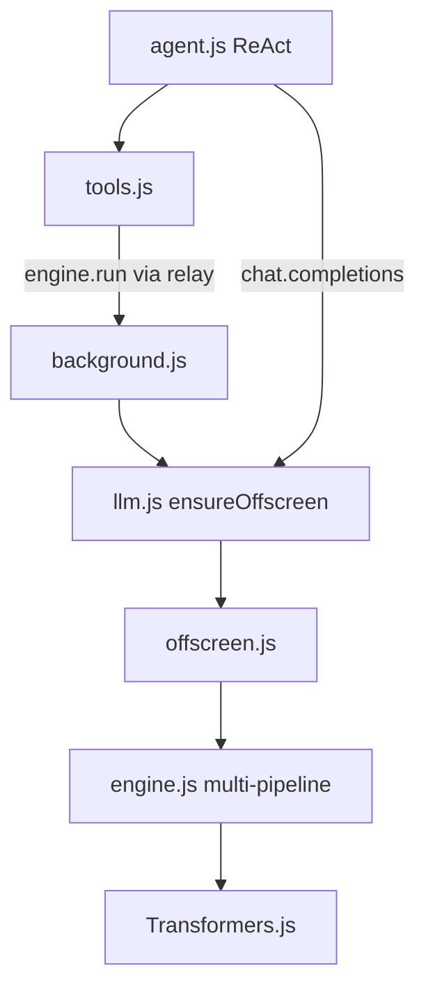

# Multimodal Transformers.js Engine

## Scope (locked)

**In scope** — Transformers.js `pipeline()` tasks only:

| Task | Agent tool | Default model (small ONNX/Xenova-class) |
|------|------------|----------------------------------------|
| `text-generation` | (existing chat path) | keep current registry |
| `image-to-text` | `describe_image` | `Xenova/vit-gpt2-image-captioning` (~250MB) |
| `image-classification` | `classify_image` | `Xenova/vit-base-patch16-224` (~90MB) |
| `automatic-speech-recognition` | `transcribe_audio` | `Xenova/whisper-tiny.en` (~80MB) |

**Out of scope:** diffusion / `text-to-image` (not a Transformers.js pipeline), TTS, object detection, Settings UI for media models (use registry defaults; LLM settings unchanged).

Image input for vision tools: **both** tab screenshot (`chrome.tabs.captureVisibleTab`) and `imageUrl` / `dataUrl` args.

## Architecture



Today [`engine.js`](browser-agent/engine.js) holds one `currentPipeline` for `text-generation`. After change it holds a **task-keyed map** of loaded pipelines, still FIFO-serialized (same GPU / WASM contention).

## 1. Generalize [`browser-agent/engine.js`](browser-agent/engine.js)

- Expand `MODEL_REGISTRY` entries with `task` + `modality` (`llm` | `vision` | `audio`). Keep existing LLM models as `task: "text-generation"`.
- Replace single `currentPipeline` / `currentModelId` with:

```js
// key = `${task}::${modelId}`
const loaded = new Map(); // { pipeline, task, modelId }
```

- Shared helpers stay: `loadTransformers()`, `probeDevice()`, IndexedDB cache via [`model-cache.js`](browser-agent/model-cache.js), progress / OOM handling.
- New public API:
  - `loadModel({ task, model })` — load (or reuse) pipeline for that task
  - `unload({ task?, model? })` — unload one or all
  - `status()` — device + list of loaded `{ task, model }` + full registry
  - `run({ task, model?, input, options? })` — ensure model loaded, call pipeline, return a **uniform result envelope**:

```js
{ task, model, output }  // or { error: { message, type } }
```

  - Keep `chatCompletions(request)` as a thin wrapper around `run({ task: "text-generation", ... })` + OpenAI shaping so [`llm.js`](browser-agent/llm.js) / offscreen `chat.completions` stay compatible.
- Memory policy: on `loadModel`, if another pipeline for the **same task** is loaded with a different model, unload it first. Different tasks may coexist (e.g. LLM + captioner) until OOM; on OOM unload the non-requesting slot and retry once.

## 2. Wire messaging in [`browser-agent/offscreen.js`](browser-agent/offscreen.js)

Add:

- `engine.run` → `engine.run(msg.request)`
- Extend `engine.load` / `engine.unload` / `engine.models` / `engine.status` to accept optional `task`
- Keep `chat.completions` unchanged for the LLM provider path

[`background.js`](browser-agent/background.js) `onnx.relay` already forwards arbitrary `engineType` — no structural change needed beyond tools calling it.

## 3. Agent tools in [`browser-agent/tools.js`](browser-agent/tools.js)

Add three tools that ensure offscreen via `ensureOffscreenDocument` from `llm.js`, then `chrome.runtime.sendMessage({ target: "onnx-engine", type: "engine.run", request })`:

- **`describe_image({ tabId?, imageUrl?, dataUrl? })`**  
  Resolve image → data URL (prefer `dataUrl`, else fetch `imageUrl` as blob→data URL, else `captureVisibleTab` for `tabId`). Run `image-to-text`. Return caption string / structured `{ caption, model }`.

- **`classify_image({ tabId?, imageUrl?, dataUrl?, topK? })`**  
  Same image resolution. Run `image-classification`. Return top labels + scores.

- **`transcribe_audio({ audioUrl?, dataUrl? })`**  
  Require URL or data URL (no mic capture in v1). Run `automatic-speech-recognition`. Return `{ text, model }`.

Helpers: `toDataUrlFromFetch(url)`, `captureTab(tabId)` — keep small and local to tools.

## 4. Agent prompt in [`browser-agent/agent.js`](browser-agent/agent.js)

Document the three new tools in `SYSTEM_PROMPT` with arg shapes so the ReAct loop can call them.

## 5. Docs

Update [`documents/tools.md`](documents/tools.md) with the three tools. Briefly note in a short comment/header in engine that registry is multi-task; no full rewrite of [`ONNX_ENGINE_PLAN.md`](ONNX_ENGINE_PLAN.md) required.

## Non-goals / constraints

- No Settings UI picker for media models in this pass (defaults from registry).
- No parallel inference (keep existing FIFO queue).
- Audio/vision inputs stay in-message as data URLs / remote URLs — be mindful of size; screenshots are JPEG quality ~0.7.
- Extending later (TTS, object detection) = add a registry row + thin tool wrapping `engine.run`.
